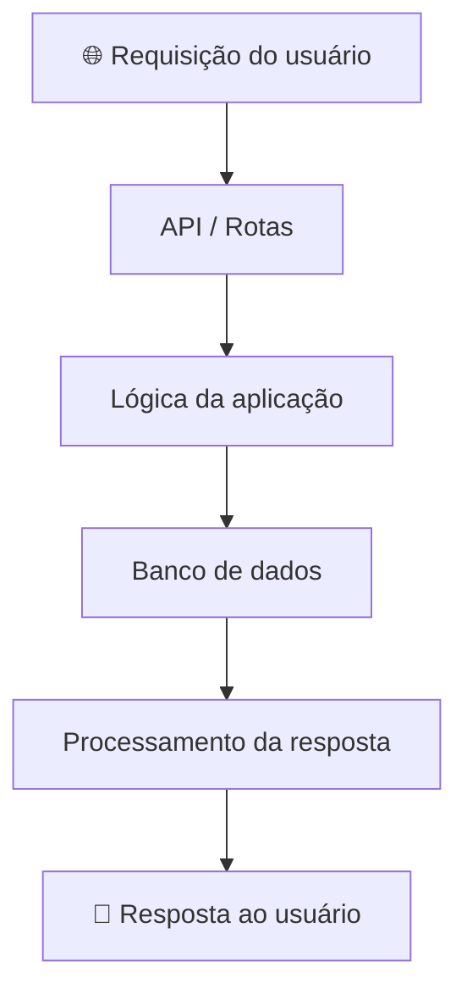

 

# 💻 Aulas Back-End 2026

 

---

## 🚀 Sobre o repositório

Este repositório reúne atividades, exercícios e projetos desenvolvidos durante as aulas de **Back-End em 2026**.

O objetivo é registrar minha evolução na programação, praticar conceitos fundamentais do desenvolvimento de sistemas e compreender como funcionam as estruturas responsáveis pelo processamento e gerenciamento de dados de uma aplicação.

## 📂 Organização do projeto

| Pasta / Arquivo | Descrição |
|---|---|
| 📡 `APIs` | Atividades relacionadas ao desenvolvimento e estudo de APIs |
| 🗄️ `BancoDados.sql` | Script SQL relacionado ao banco de dados |
| 🏗️ `MVC_Ex` | Exercícios envolvendo o padrão arquitetural MVC |
| 📖 `MVC_leitura` | Materiais e estudos sobre MVC |
| 🧩 `POO` | Práticas de Programação Orientada a Objetos |
| 📄 `json` | Atividades relacionadas ao formato JSON |
| 🛠️ `ORDEM_servicos.sql` | Script SQL relacionado a ordens de serviço |
| 📦 `POO.zip` | Arquivo compactado com materiais de POO |

## 🧠 Conteúdos estudados

- **APIs:** comunicação e integração entre aplicações.
- **Banco de dados:** armazenamento e organização de informações.
- **POO:** organização do código utilizando classes e objetos.
- **MVC:** separação de responsabilidades na estrutura de aplicações.
- **JSON:** representação e troca de dados.

## 🔄 Estrutura de uma aplicação Back-End

## 🎯 Objetivos

- Desenvolver a lógica de programação.
- Compreender o funcionamento de APIs.
- Aprender a manipular bancos de dados.
- Aplicar conceitos de Programação Orientada a Objetos.
- Conhecer padrões de organização de sistemas.
- Desenvolver aplicações com código organizado e estruturado.
- Evoluir na construção de soluções Back-End.

## 🌱 Minha evolução

Este repositório funciona como um registro da minha trajetória de aprendizado no desenvolvimento Back-End.

Cada atividade representa uma oportunidade de colocar os conhecimentos em prática, explorar novas ferramentas e aprimorar minhas habilidades como desenvolvedora.

---

### 💙 Construindo a lógica por trás das aplicações!

*Estudando, praticando e evoluindo a cada projeto.*

